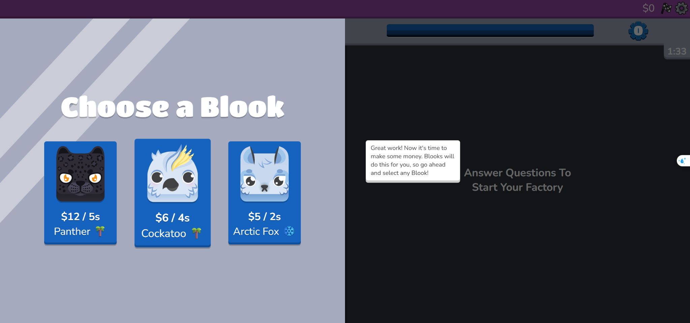
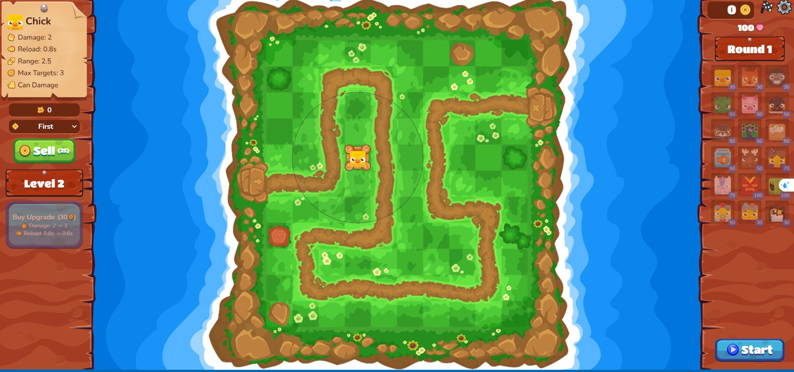
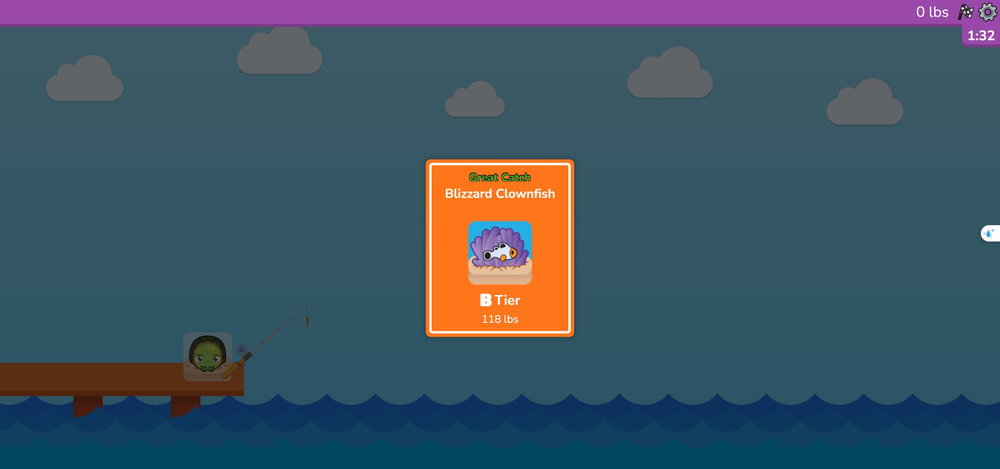
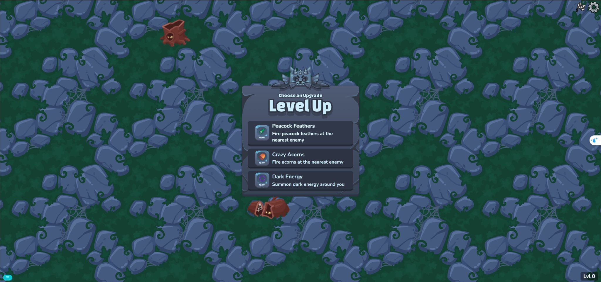
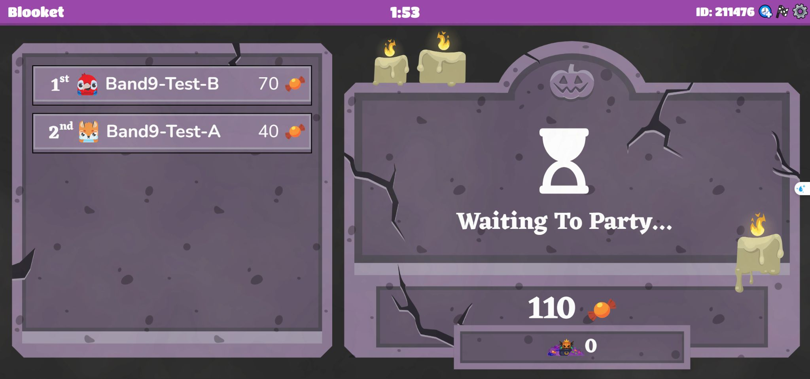

# Blooket cuốn bằng cách nào: khảo sát vận hành qua chơi thử

Bổ sung ngày 13/10/2026, tiếp nối khảo sát 12/10. Chơi trực tiếp trong Chrome của người dùng, dùng cùng bộ Common/Proper Nouns để tách ảnh hưởng của nội dung câu hỏi khỏi ảnh hưởng của cách chơi.

**Kết luận thiết kế:** sức hút đến từ những mục tiêu gần và quyết định có tác dụng trong game. Câu hỏi mở cơ hội kiếm tài nguyên hoặc nâng sức mạnh; người chơi dùng cơ hội đó để xây một chiến thuật rồi xem kết quả. Mỗi mode tạo một loại mong đợi khác nhau.

Đây là phân tích định tính từ các phiên thử ngắn, chưa có số liệu đo giữ chân hoặc kết quả học. Các đoạn “vì sao cuốn” là nhận định thiết kế dựa trên thao tác và phản hồi đã quan sát.

## 1. Phạm vi đã chơi trực tiếp

| Game | Đã thao tác và xác minh | Chưa xác minh |
| --- | --- | --- |
| Café, phiên trước | Tutorial, nhập hàng, trả lời đúng, phục vụ một khách nhận $2, tổng kết | Một ngày đầy đủ, mua nâng cấp trong quán |
| Factory | Phiên hai phút, sáu câu đúng, hai lần chọn Blook, hai máy tự kiếm tiền, tutorial cộng hưởng, tổng kết | Mua nâng cấp giá cao, đủ 10 ô, thay máy và cộng hưởng thực tế |
| Tower Defense 2 | Ô lưu trống, map Sunny Meadow / Easy, ba câu đúng, mua Chick, đặt tháp, nâng sát thương, thắng round 1, mở câu hỏi round 2 | Round khó, tháp đặc biệt, chiến thuật ở cuối game |
| Fishing Frenzy | Chế độ solo hai lượt: một đúng nhận cá 118 lbs, một cố ý sai mất cá; tổng kết 1/2 | Chưa thử host nhiều người: Chrome bị ngắt công cụ điều khiển sau phiên Cyber Hack |
| Monster Brawl | Tutorial, câu đầu, chọn Dark Energy trong ba lựa chọn, điều khiển nhân vật, xuất hiện câu tiếp khi tiến triển, nâng lên level 2 | Boss, phối nhiều vũ khí, hồi máu bằng cheese |
| Gold Quest → Candy Quest | Tạo phòng thử ba phút, hai người chơi thử, mỗi người ba câu đúng, mở ba bí ngô mỗi lượt, biến động điểm và đảo hạng, kết thúc phòng | Chưa thực hiện lấy kẹo của đối thủ; chỉ thấy Take 25% ở kết quả bí ngô không chọn |
| Cyber Hack | Host thật, hai người chơi thử ở hai trình duyệt, tutorial, chọn mật khẩu, trả lời câu, chọn output, nhận HACK, đoán đúng mật khẩu đối thủ và xác nhận chuyển credit trên host | Chỉ thử một lần hack đúng; chưa thấy hiệu ứng khi đoán sai hoặc khi người bị hack có biện pháp phòng thủ |

Gold Quest ở thời điểm khảo sát chuyển sang Candy Quest theo giao diện Halloween. Không suy ra toàn bộ luật của Gold Quest ngoài mùa từ phiên Candy Quest này.

## 2. Factory: tăng trưởng và xây đội hình

### Vòng hoạt động đã thấy

**Ba câu đúng → chọn một trong ba Blooks → máy kiếm tiền theo chu kỳ → tiếp tục ba câu → thêm máy → tích tiền để nâng cấp.**

Lượt đầu cho ba lựa chọn:

| Blook | Thu nhập hiển thị | Quy đổi tốc độ để so sánh |
| --- | --- | --- |
| Panther | $12 / 5 giây | $2,4 / giây |
| Cockatoo | $6 / 4 giây | $1,5 / giây |
| Arctic Fox | $5 / 2 giây | $2,5 / giây |

Tôi chọn Arctic Fox. Máy tiếp tục sinh tiền khi màn câu hỏi đang mở; đã thấy số tiền tăng và hiệu ứng +$5. Nút nâng cấp đầu tiên ghi $520, tutorial nói nút đổi xanh khi đủ tiền.

Lượt chọn thứ hai có Tiger, Hedgehog, Raccoon và lời nhắc ghép nhóm ❄️. Tôi chọn Raccoon $5 / 2 giây. Hai máy xuất hiện cùng nhau, từng máy có nút nâng cấp riêng.

Tutorial xác nhận máy cùng nhóm emoji tăng hệ số thu nhập, tối đa 10 máy, có thể thay máy sau khi đầy. Chưa trực tiếp tạo đội cùng nhóm nên không khẳng định mức nhân cụ thể.

### Vì sao cuốn

- Chỉ còn hai hoặc một câu là tới một phần thưởng mới: mục tiêu nhỏ luôn gần.
- Chọn máy không chỉ là chọn hình đẹp; tốc độ tiền và nhóm cộng hưởng cho lý do cân nhắc.
- Đội hình vẫn tạo tiến trình trong khi người chơi học, nên hành động trước có ích ở các lượt sau.
- Mốc dài hạn được nhìn thấy sớm: nâng máy, đầy 10 ô, thay máy để tối ưu.

### Chuyển sang Band 9

Một game quản lý có thể dùng câu đúng để mở nhân viên hoặc thiết bị. Mỗi lựa chọn có tác dụng rõ: nhanh hơn, sức chứa lớn hơn, lợi ích khi ghép nhóm. Trước khi xây mới, thử cơ chế này trong quán hoặc một phiên Thành phố hiện có.

Điều cần học là **đội hình có cộng hưởng và lựa chọn đánh đổi**. Không chỉ thêm một thanh tiền tăng tự động mà thiếu việc dùng tiền.

## 3. Tower Defense 2: học, chuẩn bị, chứng kiến kết quả

### Vòng hoạt động đã thấy

**Ba câu đúng → nhận 50 xu → mua / đặt / nâng tháp → chủ động bấm Start → tháp chống một đợt quái → Round Complete → ba câu mới.**

Tôi mua Chick giá 30, đặt vào ô cỏ cạnh đường quái. Tháp level 1 hiển thị sát thương 1, nạp lại 0,8 giây, tầm 2,5 và tối đa ba mục tiêu. Dùng 20 xu còn lại để nâng lên level 2: sát thương đổi từ 1 sang 2. Nâng tiếp cần 30 xu và còn giảm thời gian nạp xuống 0,6 giây.

Có các lựa chọn Target First và bán tháp. Tutorial cho biết mỗi tháp có năm cấp. Sau Start, nút chuyển thành x2. Round 1 kết thúc, bảng ghi round 2 và 51 xu; Next Round mở câu hỏi mới.

### Vì sao cuốn

- Người chơi có thời gian chuẩn bị và tự quyết định lúc bắt đầu; nhịp học khác nhịp chiến đấu.
- Vị trí đặt tháp và dùng xu có hậu quả nhìn thấy được.
- Nâng cấp ghi trước → sau bằng số cụ thể, giúp người chơi biết mình vừa mạnh hơn ở đâu.
- Thắng một round tạo điểm nghỉ tự nhiên và lời mời “thử cách bố trí này ở round tiếp”.

### Chuyển sang Band 9

Đây là hướng mạnh nếu muốn một game chiến thuật thực sự: **cụm câu học ngắn → ngân sách hữu hạn → quyết định bố trí → diễn biến tự chạy**. Có thể tạo một thử thách riêng dùng nội dung từ vựng hoặc câu ngắn; không phục hồi bản đồ trận cũ đã bỏ khỏi Quest nếu chưa có chỉ dẫn mới.

Chỉ số chiến thuật như vị trí, tầm, tốc độ và phối hợp cần tạo lựa chọn có ý nghĩa. Điểm học vẫn chấm độc lập với việc thắng round.

## 4. Fishing Frenzy: chờ đợi, khám phá, thử lại nhanh

### Vòng hoạt động đã thấy

**Bấm thả câu → chờ cá cắn → bấm kéo → trả lời câu hỏi → công bố cá → nhận trọng lượng → thả lại.**

Lượt đúng nhận Blizzard Clownfish, B Tier, 118 lbs. Sau bấm nhận, tổng tăng từ 0 lên 118. Tôi cố ý sai ở lượt sau: game báo INCORRECT rồi Fish Lost! Click to Cast Again. Tổng vẫn là 118.

### Vì sao cuốn

- Câu hỏi được đặt ở lúc đã có một thứ muốn lấy: người chơi vừa kéo được cá.
- Danh tính, hạng và trọng lượng cá được công bố thành một khoảnh khắc riêng.
- Không biết cá lượt sau tạo tò mò. Phiên này chưa đủ mẫu để kết luận phân bố xác suất.
- Thất bại chỉ mất cơ hội hiện tại, vẫn giữ thành quả đã kiếm, nên thử lại dễ.

### Chuyển sang Band 9

Phù hợp một trải nghiệm thu thập ngắn trong Du ngoạn: tìm hiện vật / bưu thiếp / vật phẩm theo địa điểm, trả lời để nhận rồi xem bộ sưu tập tiến lên. Có thể giữ sự bất ngờ ở vật phẩm trang trí, còn tiến trình học có quy tắc rõ.

Game này cho thấy **trình tự công bố phần thưởng** cũng quan trọng: hành động, chờ ngắn, thử thách, công bố, nhận. Không cần bắt mọi phần thưởng hiện như một thông báo nhỏ rồi biến mất.

## 5. Monster Brawl: trải nghiệm sức mạnh và chọn cách chơi

### Vòng hoạt động đã thấy

**Câu đúng đầu tiên → chọn sức mạnh → di chuyển né quái, vũ khí hoạt động → tiến triển / câu hỏi tiếp theo → nâng sức mạnh → quay lại chiến đấu.**

Lượt đầu có Peacock Feathers, Crazy Acorns và Dark Energy. Hai lựa chọn đầu mô tả bắn vào quái gần nhất; Dark Energy tạo năng lượng quanh nhân vật. Tôi chọn Dark Energy, level đổi 0 → 1 và hiệu ứng năng lượng xuất hiện.

Sau điều khiển bằng phím mũi tên, game mở câu hỏi tiếp. Trả lời đúng, lượt nâng cấp này chỉ có Dark Energy level 2, +2 damage; sau chọn, level hiển thị 2. **Không phải mọi lần nâng đều có ba lựa chọn.**

Tutorial nói đánh quái để nhặt tinh thể kinh nghiệm, lên level, mở kỹ năng; né quái và nhặt cheese để hồi máu. Đã thử di chuyển và nâng cấp; chưa thử hồi máu.

### Vì sao cuốn

- Người chơi trải nghiệm ngay sức mạnh vừa chọn trong một cảnh chuyển động.
- Câu học xuất hiện ở cửa ngõ nâng cấp, khi đang muốn mạnh lên.
- Vũ khí tự hoạt động làm người chơi tập trung vào di chuyển và lựa chọn.
- Có cảm giác xây một nhân vật trong phiên; lần sau có thể thử sức mạnh mở đầu khác.

### Chuyển sang Band 9

Nên giữ quyền chọn sức mạnh và tác dụng khác nhau nếu làm game hành động. Cần kiểm tra kỹ điều khiển trên điện thoại và việc dừng chiến đấu khi đọc câu; trong phiên quan sát, màn nâng cấp đặt trên cảnh chơi.

Không mặc định áp dụng game hành động lên mọi màn IELTS. Có thể để nó là một phiên luyện ngắn dành cho người thích phản xạ.

## 6. Candy Quest: bất ngờ và cuộc đua có thể đảo chiều

### Thiết lập thử

Tạo một phòng mới, chỉ có hai người do tôi điều khiển: Band9-Test-A và Band9-Test-B. Không mời người khác. Hai người nhận câu hỏi khác nhau và tiến triển độc lập.

**Câu đúng → chọn một trong ba bí ngô kín → mở kết quả → thấy cả hai kết quả không chọn → tiếp tục → bảng xếp hạng cập nhật.**

| Lượt | Người A | Người B | Kết quả đáng chú ý |
| --- | --- | --- | --- |
| 1 | +30 | +20 | A dẫn 30–20 dù cùng một câu đúng |
| 2 | +10, tổng 40 | +50, tổng 70 | B vượt lên dù cả hai cùng hai câu đúng |
| 3 | +10, tổng 50 | Lose 25% to the King, còn 52 | Khoảng cách thu hẹp còn hai kẹo |

Host hiển thị Pumpkin King có 18 kẹo sau khi B mất 25%. Màn cuối xác nhận B thắng 52–50. Ở các kết quả không chọn, đã thấy Take 25%, Double Candy!, Nothing! và +100 Candy; chưa trực tiếp thực hiện các hiệu ứng này.

### Vì sao cuốn

- Vị trí dẫn đầu chưa chắc giữ được, nên phần còn lại của trận vẫn có điều để chờ.
- Những kết quả bỏ lỡ khiến người chơi muốn mở tiếp. Chưa có bằng chứng rằng vị trí bí ngô cho phép đoán phần thưởng.
- Điểm của mỗi người thay đổi làm phần thưởng mang ý nghĩa xã hội, khác với một tài khoản chơi một mình.
- Tranh, vật phẩm, tên mode và mục tiêu được đổi theo mùa, khiến cùng nền câu hỏi có cảm giác mới.

### Chuyển sang Band 9

Phù hợp hoạt động lớp / nhóm bạn ngắn với điểm chỉ dùng trong trận, đặt cạnh báo cáo số câu đúng. Có thể học cách tạo sự kiện, đảo tình thế và đồng bộ bảng xếp hạng; cần quyết định mức may rủi phù hợp trước khi dùng cho cuộc thi học tập.

## 7. Cyber Hack: câu hỏi cấp cơ hội để xâm nhập đối thủ

### Vòng hoạt động đã xác minh trong phòng host

Tutorial có bốn bước: **chọn mật khẩu → trả lời câu hỏi để kiếm credit → hack người khác bằng cách đoán mật khẩu → thu nhiều credit nhất để thắng.** Host mặc định cho 7 phút, câu hỏi tự chạy theo nhịp riêng của từng người; người chơi thứ hai vẫn vào được sau khi ván bắt đầu vì host đang bật cho người vào muộn.

Sau câu đúng, người chơi mở một trong ba output đang úp. Các lần mở thử lần lượt cho thấy Blook kèm +20, +50, +10 credit hoặc vật phẩm **HACK**. Chưa đủ mẫu để khẳng định tỉ lệ hay quy luật rơi vật phẩm. Sau khi nhận HACK, game chọn một người chơi khác và đưa ba lựa chọn mật khẩu. Lần thử đúng đã nhắm vào Band9-Test; game báo **CORRECT** rồi host hiện “Band9-Guest just took 33 credits from Band9-Test”. Bảng điểm đổi từ 70–10 trước lần hack thành 43–37 sau đó, tổng credit vẫn là 80.

Trả lời sai khiến người chơi bị chờ vài giây trước khi tiếp tục. Thiết lập host mặc định hiển thị phạt 3 giây, nhưng chưa đo chính xác thời gian thực. Bảng xếp hạng trong game và host cập nhật ngay, nên người chơi thấy tác động lên cả hai phía.

### Vì sao cuốn

- Mỗi câu đúng mở một cơ hội bất ngờ; người chơi không biết output là credit, Blook hay HACK.
- Phần thưởng có thể tạo lựa chọn xã hội. Có HACK thì người chơi tự chọn đối thủ rồi đoán mật khẩu, thay vì chỉ nhận điểm tăng đều.
- Trận có thể đổi hạng ngay sau một thao tác. Dòng sự kiện trên host giải thích cụ thể ai lấy credit của ai.
- Mật khẩu là thứ người chơi tự chọn lúc vào game, nên một câu đúng mở thêm một bước chiến thuật: nhớ hoặc đoán lựa chọn của đối thủ.

### Chuyển sang Band 9

Có thể dùng cùng nhịp **câu hỏi → mở một phần thưởng ngẫu nhiên → nhận quyền hành động → ảnh hưởng đối thủ**, nhưng đổi “mật khẩu” thành mã chủ đề hoặc đáp án từ vựng tạm thời của ván. Khi dùng trong lớp, giới hạn lượng điểm có thể chuyển và giải thích rõ kết quả để cú lật hạng tạo kịch tính mà không làm người chơi thấy công sức học biến mất hết. Blook nên được thay bằng huy hiệu hoặc công cụ hỗ trợ học có tác dụng rõ trong ván.

## 8. Các cơ chế chung nên đưa vào bản thiết kế Band 9

1. **Mục tiêu gần:** luôn nhìn thấy còn bao nhiêu câu tới lựa chọn / nâng cấp tiếp. Factory dùng ba câu, Tower Defense dùng cụm ba câu trước mỗi round; không bắt đầu bằng một chuỗi dài mới được chơi.
2. **Quyền quyết định:** chọn đội, vị trí, nâng cấp, tài nguyên. Lựa chọn phải làm cách chơi thay đổi.
3. **Tác dụng tức thì:** sau nâng cấp phải thấy hiệu ứng hoặc hành vi mới, không chỉ số XP tăng.
4. **Nhịp xen kẽ:** câu hỏi → quyết định → hành động → phản hồi → câu hỏi. Mỗi game có thời lượng và điểm nghỉ riêng.
5. **Tiến trình trong phiên:** nhân vật hoặc đội hình mạnh lên rõ qua vài phút, đủ để một phiên học có câu chuyện riêng.
6. **Có đường thử lại:** Fishing Frenzy giữ cá đã kiếm; Tower Defense có ô lưu. Hậu quả thất bại cần dễ hiểu.
7. **Nội dung tái sử dụng, trải nghiệm khác:** cùng một bộ câu hỏi nhưng mỗi mode có hành động và động lực riêng.
8. **Tổng kết hai lớp:** kết quả học và kết quả chơi đều rõ. Trong trận Candy Quest, cùng ba câu đúng vẫn có điểm 52 và 50.

## 9. Điều chỉnh hướng áp dụng so với khảo sát ban đầu

Quán cà phê thuận lợi để triển khai vì Band 9 đã có nền. Tuy nhiên, nếu mục tiêu chính là sức hút gameplay, bản mẫu đầu tiên phải chứng minh **một quyết định làm cách chơi thay đổi**, trước khi dành nhiều công sức cho sảnh, bộ sưu tập hay hiệu ứng.

Đề xuất làm hai thử nghiệm thiết kế nhỏ để so sánh:

- **Quán:** cụm câu → bổ sung nguyên liệu → chọn nâng sức chứa hoặc mở món có lãi tốt hơn → phục vụ nhóm khách tiếp. Người chơi tự chọn giữa chuẩn bị nhiều và doanh thu cao.
- **Chiến thuật:** cụm câu → một ngân sách hữu hạn → chọn hai kiểu công cụ có ưu / nhược khác nhau → chạy một round ngắn → thấy kết quả. Không chỉ thưởng thêm sát thương cố định cho mỗi câu.

Đây là đề xuất tiếp theo, chưa triển khai trong ứng dụng. Nên cho người học thử và đo số câu làm, mức hiểu lỗi và mức muốn chơi tiếp; chưa thể khẳng định cách nào hiệu quả hơn chỉ từ khảo sát Blooket.

## 10. Trạng thái sau khảo sát và bằng chứng

- Factory và Fishing Frenzy đã kết thúc theo thời gian; Monster Brawl và Tower Defense 2 đã được kết thúc sớm sau các thao tác thử.
- Tower Defense 2 dùng ô lưu thứ hai vốn trống; game cũ ở ô thứ nhất không bị thay thế. Có thể còn bản lưu của phiên khảo sát.
- Phòng Candy Quest đã kết thúc, màn Final Standings được xác nhận.
- Các lượt thử có thể cập nhật lịch sử, XP, achievements và token Blooket theo cơ chế của sản phẩm. Không mua vật phẩm hay dùng tokens để mua gói.
- Chưa sửa mã Band 9. Nghiên cứu này không đọc mã nguồn nội bộ hoặc đo hạ tầng Blooket.
- Đã thử lập lobby Fishing tiếp theo nhưng Chrome mất kết nối điều khiển sau phiên Cyber Hack, nên chưa xác minh vòng Fishing nhiều người. Các ghi chú Fishing trong bảng và mục 4 chỉ dựa trên phiên solo trước đó.

Bằng chứng bổ sung trong cùng thư mục: `factory-choice.jpg`, `factory-running.jpg`, `defense-upgrade.jpg`, `defense-wave.jpg`, `fishing-catch.jpg`, `fishing-lost.jpg`, `brawl-upgrade-choice.jpg`, `brawl-running.jpg`, `brawl-level2.jpg`, `candy-choice.jpg`, `candy-host-ranking.jpg`, `candy-rank-reversal.jpg`, `candy-event-king.jpg`, `candy-player-leaderboard.jpg`, `candy-final.jpg`. Cyber Hack được xác minh qua trạng thái hiển thị của host và hai người chơi thử; Chrome bị ngắt công cụ chụp ảnh sau khi quan sát xong.

Nguồn trực tiếp: [bộ câu hỏi dùng trong các phiên](https://dashboard.blooket.com/set/63d6eeff7a722c406bc114b3), [Solo picker](https://play.blooket.com/solo?id=63d6eeff7a722c406bc114b3), [Host picker](https://play.blooket.com/host?id=63d6eeff7a722c406bc114b3). Xem thêm [bản khảo sát giao diện và đối chiếu workspace](./REPORT.md).
