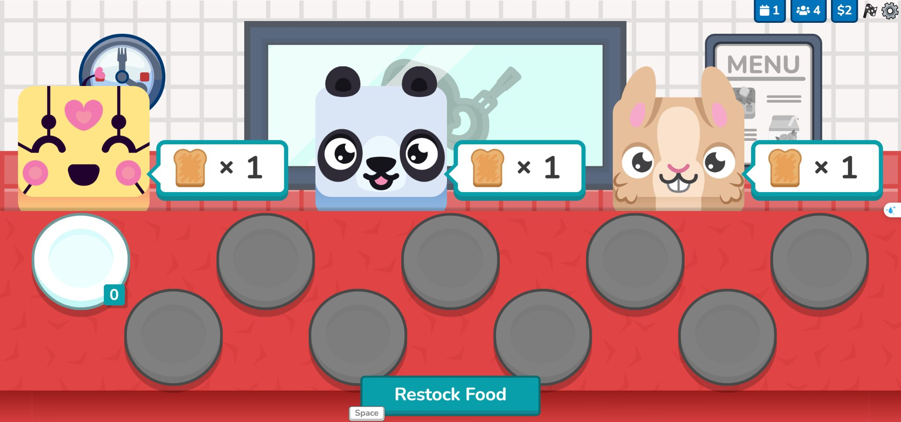

# Blooket → Band 9: khảo sát game và bản thiết kế áp dụng

Ngày khảo sát: 12/10/2026. Khảo sát trực tiếp trong Chrome của người dùng, bằng phiên Blooket đang đăng nhập.

**Bổ sung 13/10:** đã chơi thêm Factory, Tower Defense 2, Fishing Frenzy, Monster Brawl và Candy Quest hai người. Sau đó đã host Cyber Hack, cho hai người chơi thử vào bằng hai trình duyệt và xác nhận một lần hack chuyển 33 credit. Xem [phân tích vận hành qua chơi thử](./GAMEPLAY.md) để đọc vòng chơi và kết quả. Các giới hạn bên dưới ghi nhận khảo sát ban đầu ngày 12/10.

**Đề xuất chính:** nâng cấp quán cà phê đang có thành một cảnh chơi tương tác: đọc hoặc nghe khách gọi món → trả lời → nhận nguyên liệu → phục vụ → thấy tiền tăng → chọn nâng cấp sau ca. Dùng chung bộ câu hỏi cho nhiều cách chơi, nhưng mỗi game phải có hành động và quyết định riêng.

## 1. Phạm vi và mức độ xác minh

Đã xem trực tiếp:

- Trang chọn Live Game Mode, gồm 20 lựa chọn tại thời điểm khảo sát; một số ghi Plus Only hoặc Beta.
- Mô tả Café, Factory, Tower Defense 2, Monster Brawl, Gold Quest, Classic, Racing và Cyber Hack.
- Trang cấu hình host Café: điều kiện kết thúc, phạt câu sai, thứ tự câu hỏi, âm thanh và quyền tham gia.
- Discover, trang chi tiết bộ Common/Proper Nouns và luồng Play Solo.
- Bộ chọn Solo có 12 lựa chọn, gồm Snake Escape Beta và Study.
- Một phiên Café mới: toàn bộ hướng dẫn ban đầu, trả lời một câu đúng, nhập một phần toast, phục vụ một khách nhận $2, kết thúc sớm và xem tổng kết từng câu.
- Market và My Blooks: gói theo chủ đề, cửa hàng tuần, độ hiếm, nhân vật đã có và chưa có.

**Giới hạn của khảo sát ban đầu:** gameplay trực tiếp chỉ được thử ở Café. Các mode khác được so sánh qua màn mô tả và bộ chọn, chưa chơi hết vòng. Chưa khảo sát trận đông người, khả năng chịu tải, thiết bị di động hoặc mã nguồn nội bộ của Blooket. Nhận xét về kiến trúc bên dưới là đề xuất cho Band 9, không phải kết luận về cách Blooket viết mã.

Phiên Café ban đầu đã được kết thúc; Blooket ghi nhận một game, một câu đúng và một khách, đồng thời màn thưởng hiển thị tổng 22 tokens và 2 XP. Phần thử live Cyber Hack được bổ sung riêng trong ghi chép ngày 13/10. Không mua vật phẩm.

Hướng dẫn Solo chính thức đang liệt kê bảy mode, trong khi giao diện trực tiếp của phiên này có 12. Vì vậy danh mục hiện tại trong báo cáo dựa trên giao diện đã quan sát, không dùng danh sách cũ làm danh sách đầy đủ. [Nguồn chính thức](https://help.blooket.com/hc/en-us/articles/16289290268567-How-to-Play-a-Solo-Game-in-Blooket).

## 2. Những cơ chế đáng học

### Bộ câu hỏi và game được chọn riêng

Discover → chọn bộ câu hỏi → Play Solo / Host Game / Assign HW → chọn mode. Nội dung học có thể dùng lại mà trải nghiệm đổi theo mode. Band 9 nên áp dụng trước cho từ vựng, collocation, câu ngắn và SAT vocabulary.

Không chia một bài Reading dài thành câu hỏi rời thiếu đoạn văn; không dùng điểm thắng game để suy ra band IELTS. Writing và Speaking cần tiêu chí riêng, không chuyển tùy tiện thành trắc nghiệm tốc độ.

### Câu trả lời tạo ra hành động trong thế giới

Café được xác minh trực tiếp:

1. Ba khách xuất hiện, mỗi người cần một phần toast; kho đang bằng 0.
2. Restock Food mở màn câu hỏi.
3. Trả lời đúng → màn CORRECT → bấm tiếp tục.
4. Quay lại quán, kho toast tăng từ 0 lên 1.
5. Bấm khách → dùng một phần toast → khách cảm ơn → tiền tăng từ $0 lên $2.
6. Hướng dẫn cho biết hết ngày có thể mua nâng cấp trong shop.

Câu hỏi là một bước trong chuỗi hành động có mục tiêu. Động lực tiếp theo là khách đang chờ và tài nguyên thiếu, không chỉ một nút “câu tiếp theo”.

### Hướng dẫn theo tình huống

Café hỏi có muốn tutorial không. Mỗi bước chỉ một việc: nhận ra khách → nhìn kho → nhập hàng bằng câu hỏi → phục vụ → hiểu thanh trạng thái → biết lúc nâng cấp. Có thể học thao tác trên chính cảnh chơi.

Band 9 nên đưa người mới vào một lượt phục vụ mẫu miễn phí, rồi cho tự chơi. Mỗi chú thích một câu; chỉ làm tối vùng ngoài điểm cần bấm. Người đã biết có thể bỏ qua.

### Mastery gắn việc chơi với ôn lỗi

Host Café có Random, Ordered và Mastery. Khi chọn Mastery, mô tả nói câu được sắp theo độ chính xác và câu từng trả lời sai xuất hiện thường xuyên hơn. Solo có công tắc Use Mastery Mode.

Đây là bằng chứng về quy tắc hiển thị, chưa xác minh thuật toán hay các trọng số nội bộ. Band 9 nên dùng lịch ôn hiện có làm nền, ưu tiên từ đến hạn và lỗi trong phiên; cho câu sai xuất hiện lại sau vài câu khác thay vì lặp ngay để học thuộc vị trí đáp án.

### Game kết thúc nhưng tiến trình còn tiếp tục

Màn tổng kết Café tách số câu, độ chính xác và chi tiết từng câu khỏi Class Pass, XP, achievements, token và liên kết cửa hàng. Market trình bày bộ sưu tập theo chủ đề; My Blooks đặt món đã có và chưa có cạnh nhau.

Band 9 có thể tạo bộ quà “Hà Nội”, “Đời sống du học”, “Phòng học”, với mục tiêu cụ thể như hoàn thành sáu món. Ưu tiên phần thưởng chọn được và trang trí; chỉ số trình độ học tập vẫn dựa vào kết quả luyện tập.

## 3. Các mode đã đối chiếu

Thông số sau lấy từ trang host trực tiếp, là thời lượng gợi ý và nhãn kỹ năng của Blooket.

| Mode | Nhãn kỹ năng | Thời lượng | Nhịp câu hỏi | Hướng áp dụng cho Band 9 |
| --- | --- | --- | --- | --- |
| Café | Speed & Strategy | 7 phút | Tự làm, tần suất cao | Quán đang có: nguyên liệu, khách, nâng cấp theo ca |
| Factory | Strategy & Speed | 7 phút | Tự làm, tần suất cao | Dùng cho một phiên sản xuất ngắn sau khi quán đã hoàn thiện |
| Tower Defense 2 | Strategy & Accuracy | 10 phút | Tự làm, tần suất thường | Tham khảo cách gắn độ chính xác với quyết định dùng tài nguyên trong Thành phố |
| Monster Brawl | Dexterity & Strategy | 8 phút | Tự làm, tần suất thường | Chỉ nên cân nhắc sau; cần kiểm tra thao tác trên điện thoại |
| Gold Quest | Luck & Speed | 7 phút | Tự làm, tần suất cao | Tham khảo sự bất ngờ cho quà trang trí, không dùng may rủi tính trình độ |
| Classic | Speed & Accuracy | 7 phút | Câu hỏi đồng bộ | Phù hợp chế độ lớp học trong tương lai |
| Racing | Speed & Accuracy | 5 phút | Tự làm, tần suất cao | Nâng cấp hình ảnh đường đua cho đấu từ vựng hiện có |
| Cyber Hack | Memory & Speed | 7 phút | Tự làm, tần suất thường | Tham khảo một mode ghi nhớ, chưa đủ dữ liệu gameplay để chốt luật |

Các hướng áp dụng ngoài Café là ý tưởng thiết kế, không phải xác nhận gameplay đã trải nghiệm.

## 4. Thiết kế giao diện nên chuyển sang Band 9

### Bộ chọn game

Blooket dùng lưới logo minh họa lớn, panel chi tiết bên phải và một nút Host nổi bật. Panel cho biết độ khó, kỹ năng, thời lượng, nhịp câu hỏi và số người. Mode khóa giảm độ nổi và có nhãn rõ.

Thông số đọc từ DOM ở cửa sổ khảo sát:

- Thẻ chọn mode khoảng 270 × 155,7 px, bo 7 px, nền trong suốt; thẻ được chọn có nền trắng 10%.
- Chữ tiêu đề và nút Host dùng Titan One; tiêu đề 56 px ở viewport đã xem. Chữ giao diện dùng Nunito.
- Nút Host nền RGB(147, 5, 213), bo 7 px, có bóng inset phía dưới tạo độ nổi.
- Mỗi mode có logo và tranh minh họa riêng; nền có họa tiết nhân vật mờ.

Kích thước này là số đo ở một viewport, không phải token áp dụng cho mọi màn hình.

Band 9 giữ logo, màu vàng kim và thế giới pixel hiện có. Sảnh Quest có thể thêm khối “Chơi nhanh” dưới phần Du ngoạn đang ghim, không phục hồi bản đồ trận đã được bỏ trước đây. Trước mắt chỉ giới thiệu các mode đã thực sự sẵn sàng.

Mỗi thẻ cần tranh cảnh chơi thật, tên game, kỹ năng luyện, thời lượng và nút vào chơi. Trên desktop: chọn thẻ để cập nhật phần xem trước. Trên điện thoại: thẻ mở phần chi tiết ngay bên dưới hoặc một màn chi tiết; không ép panel cạnh bên.

### Cảnh chơi

Quán chiếm phần lớn diện tích. Khách và món gọi đọc được ngay; thanh trên chỉ giữ tiền trong ca, nguyên liệu và số khách còn lại. Nút chính đổi theo việc cần làm: “Chuẩn bị nguyên liệu”, “Phục vụ”, “Chọn nâng cấp”.

Ở màn câu hỏi: câu hỏi có khoảng thở, đáp án lớn, nội dung dài vẫn xuống dòng dễ đọc. Màu đáp án chỉ là phụ trợ; trạng thái đúng/sai có chữ và biểu tượng. Âm thanh có nút tắt. Hiệu ứng ngắn, không che thông tin cần sửa lỗi.

Band 9 nên thêm lý do đúng/sai và phát âm từ, vì đó là giá trị học IELTS. Thời gian xem giải thích không bị tính là chậm. Có chế độ giảm chuyển động và thao tác bằng bàn phím.

## 5. Bản thiết kế ưu tiên: Quán Band 9

### Tận dụng phần đang có

- `app/quest/study-abroad/cafe.tsx`: đã có quán, số dư, khách, thực đơn và món riêng.
- `src/components/startup/ServeFlow.tsx`: luồng chọn món, pha chế, trả lời khách.
- `src/services/startup/orders.ts`: chấm lựa chọn phục vụ.
- `src/services/startup/economy.ts`: vốn mở quán, lãi, giới hạn 12 đơn/ngày và khóa chống ghi một đơn hai lần.
- `src/store/useStartupStore.ts`: trạng thái quán và sổ giao dịch.

Đây là phần có trong workspace tại thời điểm khảo sát; chưa xác minh toàn bộ đã được triển khai trên website công khai.

### Một ca mẫu

1. Vào quán → chọn ca luyện khoảng năm phút hoặc sáu khách; đây là thông số đề xuất ban đầu.
2. Khách nói “Could I have an iced coffee with less sugar?” bằng chữ; bật nghe nếu có audio.
3. Người học chọn món và hiểu yêu cầu. Thiếu nguyên liệu thì làm một câu ôn ngắn để bổ sung.
4. Pha chế và chọn câu đáp lịch sự; feedback giải thích cả lựa chọn ngôn ngữ lẫn kết quả phục vụ.
5. Phục vụ đúng → khách nhận món, tiền trong ca tăng, hàng chờ tiến lên.
6. Hết ca → chọn giữa nâng sức chứa nguyên liệu, mở món mới hoặc trang trí quán.
7. Tổng kết → số câu đúng, yêu cầu nghe hiểu còn sai, từ cần ôn, thu nhập và nút luyện lại lỗi.

Không bắt mọi khách làm nhiều bước giống nhau. Luân phiên lượt ngắn và đơn cần suy luận để tránh biến trò chơi thành một biểu mẫu dài.

### Tài nguyên và thưởng

Giữ ba lớp rõ ràng:

| Lớp | Dùng để làm gì | Cách cập nhật |
| --- | --- | --- |
| Kết quả học | Độ chính xác, lỗi, lịch ôn | Theo câu trả lời thật; game không cộng giả độ thành thạo |
| Tài nguyên ca | Nguyên liệu và tiền dùng trong ca | Theo câu đúng và khách đã phục vụ |
| Tiến trình lâu dài | Lãi quán, XP, sao, đồ trang trí | Dùng các hệ hiện có và quy tắc thưởng thống nhất |

Trước khi thêm thưởng, kiểm tra đường đi hiện có: `useGameStore.answer` đã gọi `useCityStore.earn`. Gọi thêm thưởng Thành phố lần nữa sẽ có nguy cơ cộng trùng. Không cộng cùng một khoản vào lãi quán, đồng du học và sao nếu chưa có quy tắc chuyển đổi rõ.

Tái sử dụng mã lượt phục vụ để chống bấm hai lần, tải lại hoặc đồng bộ lại cùng một sự kiện. Quy tắc tài nguyên trong ca phải tách khỏi sổ giao dịch lâu dài; thu nhập được ghi tại thời điểm đã xác minh phục vụ thành công.

## 6. Thứ tự triển khai đề xuất

1. **Hoàn thiện quán hiện có:** cảnh khách, kho nguyên liệu, kết quả phục vụ và kết thúc ca. Hướng dẫn một lượt mẫu, âm thanh tùy chọn, giao diện điện thoại.
2. **Ôn lỗi chung cho game:** lịch ôn và câu sai trong phiên, kết quả học nhất quán, ngăn thưởng trùng.
3. **Sảnh chọn game:** thêm Chơi nhanh vào Quest khi đã có trải nghiệm chơi hoàn chỉnh; giữ Du ngoạn ở vị trí đã ghim.
4. **Đường đua từ vựng:** nâng giao diện `app/duel/index.tsx` và `app/duel/[code].tsx`; kiểm tra lại tính công bằng, đồng bộ và mất kết nối trước khi mở rộng số người.
5. **Bộ sưu tập:** nhóm đồ quán, nội thất và quà du ngoạn theo chủ đề, cho thấy mục tiêu sở hữu tiếp theo.

Thành phố đã có vật liệu kiếm từ câu học và điều kiện lên kỷ trong `src/services/city/materials.ts` / `progression.ts`. Nên cải thiện cách cho người chơi thấy mục tiêu tiếp theo trước khi tạo thêm game xây dựng riêng.

## 7. Điều kiện để bản đầu tiên được coi là hoàn chỉnh

- Người mới hoàn thành một lượt phục vụ từ đầu đến cuối ngay trong hướng dẫn.
- Câu đúng tạo thay đổi nhìn thấy được trong cảnh; câu sai có giải thích và cách thử lại.
- Hết ca có ít nhất hai lựa chọn nâng cấp hữu ích, tác dụng ghi rõ.
- Điểm học, tiền trong ca và thưởng lâu dài được trình bày riêng, không suy ra band IELTS từ XP.
- Lỗi học xuất hiện ở tổng kết và đi vào đường ôn phù hợp.
- Tải lại và bấm lặp không tạo thưởng trùng; chuyển thiết bị không làm nhân đôi giao dịch.
- Trên điện thoại, câu hỏi, khách và nút chính không bị che; có đường thao tác bàn phím trên web.
- Khi game đang tắt, các bài luyện thông thường vẫn hoạt động như hiện tại.

Theo dõi tỷ lệ hoàn thành lượt đầu, hoàn thành ca, chọn luyện lại lỗi, độ chính xác khi gặp lại từ và số phiên quay lại. Chưa có dữ liệu đo hiệu quả; mọi mục tiêu thời lượng và số khách cần được điều chỉnh sau khi chơi thử.

## 8. Bằng chứng và nguồn

Ảnh chụp trong thư mục này:

- [Live mode picker](./live-mode-picker.jpg)
- [Solo Café picker](./solo-cafe-picker.jpg)
- [Cấu hình host Café](./host-cafe-settings.jpg)
- [Mastery: mô tả ưu tiên câu sai](./host-mastery.jpg)
- [Màn câu hỏi Café](./cafe-question.jpg)
- [Feedback đúng](./cafe-correct.jpg)
- [Cảnh Café sau tutorial](./cafe-gameplay.jpg)
- [Tổng kết và phần thưởng](./cafe-results.jpg)
- [Chi tiết kết quả từng câu](./question-review.jpg)
- [Market](./market.jpg)
- [Bộ sưu tập Blooks](./blooks-collection.jpg)
- [Thông số sáu mode được trích từ giao diện](./mode-evidence.json)

Trang đã khảo sát: [Host](https://play.blooket.com/host?id=5fad491512c8620004918ace), [bộ câu hỏi tiếng Anh](https://dashboard.blooket.com/set/63d6eeff7a722c406bc114b3), [Solo picker](https://play.blooket.com/solo?id=63d6eeff7a722c406bc114b3), [Market](https://dashboard.blooket.com/market), [Blooks](https://dashboard.blooket.com/blooks).

Nguồn bổ sung chính thức: [cách chơi Solo](https://help.blooket.com/hc/en-us/articles/16289290268567-How-to-Play-a-Solo-Game-in-Blooket), [cách tìm bộ câu hỏi](https://help.blooket.com/hc/en-us/articles/16288524239255-How-to-Find-Blooket-Question-Sets), [Expo SDK 57](https://docs.expo.dev/versions/v57.0.0/), đã đọc theo AGENTS.md. Chưa thay đổi mã ứng dụng trong lần khảo sát này.
